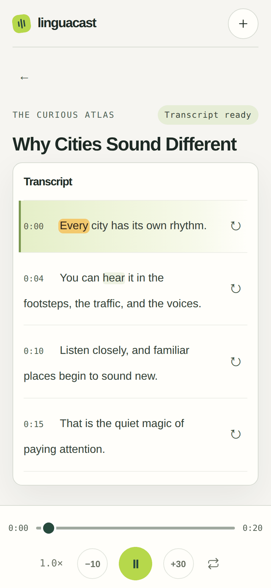

# LinguaCast

Turn an English podcast into a listening lesson. LinguaCast creates a transcript on your own computer, with word-level timing, so you can tap a word or sentence to hear it again.

This 390 × 844 demo was captured in a mobile browser emulator. It uses a fictional show, transcript, and generated audio. [View a still screenshot](docs/mobile-demo.png).



## Listen, read, repeat

- Add a podcast with its **RSS feed URL** and browse its episodes.
- Create an English transcript locally with `faster-whisper` on your CPU. No transcription API key or paid transcription service is required.
- Follow the audio with sentence-by-sentence text and word-level timestamps. Tap a word to seek to it, or replay a sentence.
- Adjust playback from 0.5× to 2.0×. LinguaCast follows the current line as you listen and remembers playback position and speed in your browser.
- Use the responsive web interface on a phone, including an iPhone browser.

## Get started

You need Python 3.10–3.12. From the project directory:

```sh
python3 -m venv .venv
source .venv/bin/activate
python -m pip install -r requirements.txt
uvicorn app:app --host 127.0.0.1 --port 8000
```

Open <http://127.0.0.1:8000> in a browser on the same computer.

The default speech model is `small.en`. On its first use, faster-whisper downloads that model; this requires an internet connection. LinguaCast also needs internet access to fetch the RSS feed and episode audio. Once the model and audio are downloaded, speech recognition runs locally on the CPU.

## Your first episode

1. In LinguaCast, tap the **+** button and paste the podcast's RSS feed URL.
2. Choose a show, then open an episode.
3. Choose **Create transcript**. The episode audio is downloaded and cached, then transcription begins. Progress is shown on the episode screen.
4. When the transcript is ready, press play. Tap any word to jump to that point, or use the repeat control beside a sentence to practice it again.

An Apple Podcasts **share link** points to an episode page and is not the RSS feed URL LinguaCast expects. Look for the podcast's RSS link on its website or in the podcast provider's settings. Some providers give subscribers a private RSS URL; treat it like a password because it may contain an access token.

## Use it from an iPhone

LinguaCast is a web app, so there is no iOS app to install. To use it on an iPhone, open its address in Safari while the phone can securely reach the computer running LinguaCast—for example, through your own private VPN or an authenticated private proxy. The default server command above listens only on that computer (`127.0.0.1`), so it will not be reachable from your phone as-is.

LinguaCast has **no login or access control**. Do not expose it directly to your local network or the public internet. Anyone who can reach an exposed instance could see registered feed URLs and cached audio. Configure and secure any remote access separately.

## Models and speed

The English-only models trade transcription speed for accuracy:

| Setting | Use when |
| --- | --- |
| `tiny.en` | You want the quickest, lightest option |
| `base.en` | You want a middle ground |
| `small.en` (default) | You want the default accuracy/speed balance |

Set the model before starting LinguaCast, for example:

```sh
WHISPER_MODEL=base.en uvicorn app:app --host 127.0.0.1 --port 8000
```

`WHISPER_CPU_THREADS` can set the number of CPU threads. Transcription time depends on your processor, model, audio, and other workloads; long episodes can take a while. LinguaCast processes one transcription at a time.

## Data and limitations

- Feed details, episode records, transcripts, and downloaded episode audio are stored locally in `data/` by default. Change the location with `PODCAST_DATA_DIR=/path/to/data`.
- The downloaded speech model is cached by faster-whisper in the user's Hugging Face cache, separately from `data/`.
- Playback position and speed are saved in the current browser's local storage. They are not synced between devices.
- Transcription jobs are held in memory. If the server restarts during a job, retry that episode after restarting.
- Transcription is English-focused and may make mistakes, especially with noisy audio, accents, music, or specialized vocabulary. Word timing and sentence boundaries are generated automatically and may need interpretation.
- LinguaCast reads RSS/Atom feeds that include HTTP(S) audio enclosures. It does not extract an RSS feed URL from an Apple Podcasts share link.

## Licensing

This repository does not currently include a `LICENSE` file, so no license for LinguaCast itself is stated here. The application, its dependencies, and the selected speech model have separate licensing terms. Check each upstream project's license and model terms before redistribution or commercial use. You are also responsible for following the podcast provider's terms when accessing or using its feed and audio.
