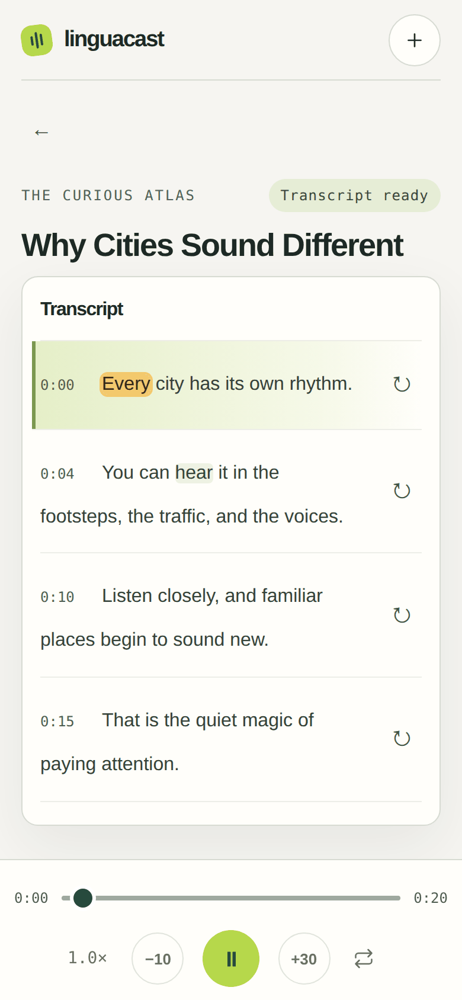

# LinguaCast

Turn an English podcast into a listening lesson. LinguaCast creates a transcript on your own computer, with word-level timing, so you can tap a word or sentence to hear it again.

This 390 × 844 demo was captured in a mobile browser emulator. It uses a fictional show, transcript, and generated audio. [View a still screenshot](docs/mobile-demo.png).



## Listen, read, repeat

- Add a podcast with its **RSS feed URL** and browse its episodes.
- Create an English transcript locally with `faster-whisper` on your CPU. No transcription API key or paid transcription service is required.
- Follow the audio with sentence-by-sentence text and word-level timestamps. Tap a word to seek to it, or replay a sentence.
- Adjust playback from 0.5× to 2.0×. LinguaCast follows the current line as you listen and remembers playback position and speed in your browser.
- Use the responsive web interface on a phone, including an iPhone browser.

## Get started

You need Python 3.10–3.12. From the project directory:

```sh
python3 -m venv .venv
source .venv/bin/activate
python -m pip install -r requirements.txt
uvicorn app:app --host 127.0.0.1 --port 8000
```

Open <http://127.0.0.1:8000> in a browser on the same computer.

The default speech model is `small.en`. On its first use, faster-whisper downloads that model; this requires an internet connection. LinguaCast also needs internet access to fetch the RSS feed and episode audio. Once the model and audio are downloaded, speech recognition runs locally on the CPU.

## Your first episode

1. In LinguaCast, tap the **+** button and paste the podcast's RSS feed URL.
2. Choose a show, then open an episode.
3. Choose **Create transcript**. The episode audio is downloaded and cached, then transcription begins. Progress is shown on the episode screen.
4. When the transcript is ready, press play. Tap any word to jump to that point, or use the repeat control beside a sentence to practice it again.

## Record a shadowing take

1. Open a transcript sentence and tap its microphone icon.
2. Tap **Record** and allow microphone access. LinguaCast plays that sentence from the original episode while recording your voice.
3. Tap **Stop recording** when you finish. If the original sentence ends first, the recording stays active so you can finish the phrase.
4. Replay **Original**, **My recording**, or **Play together**. Use the offset buttons to move the recording earlier or later in 0.1-second steps, up to 1.5 seconds.

Recordings stay in memory in the current page only. A new take replaces the previous take; closing the player, opening another episode, hiding the page, or leaving it clears the take and stops microphone tracks. LinguaCast does not upload or persist recordings. The player measures the recorder-to-playback startup delay and applies it as the initial alignment offset, rounded to 0.1 seconds and limited to 1.5 seconds; use the offset controls to refine it. Allow microphone access when prompted and use headphones to reduce the original audio leaking into the recording. Recording requires a browser that supports microphone capture and MediaRecorder. iPhone/WebKit and Bluetooth timing still need device testing.

## Automatic transcripts for new episodes

LinguaCast checks registered RSS feeds for new releases while its server is running. It checks every 15 minutes by default; set `AUTO_REFRESH_INTERVAL_SECONDS` to change the interval. Automatic transcription starts only for episodes published after a feed was registered. Episodes already in the feed at registration are the baseline and are not transcribed automatically, so this does not create a backlog. When upgrading an existing library, the episodes currently in each feed become its baseline. Episodes with a missing, invalid, or older publication date are skipped because LinguaCast cannot reliably determine that they are new.

The server downloads eligible episode audio and transcribes it on the CPU, one episode at a time. The episode list shows whether a transcript is queued, downloading, in progress, ready, or failed. A failed episode can be retried from its player screen with **Create transcript**. Keep the LinguaCast server running for feed checks and automatic transcription; opening the app in a browser is not required. Automatic jobs that were queued or in progress when the server stopped resume after restart. Interrupted manual jobs are marked failed and can be retried from the episode screen.

An Apple Podcasts **share link** points to an episode page and is not the RSS feed URL LinguaCast expects. Look for the podcast's RSS link on its website or in the podcast provider's settings. Some providers give subscribers a private RSS URL; treat it like a password because it may contain an access token.

## Use it from an iPhone

LinguaCast is a web app, so there is no iOS app to install. To use it on an iPhone, open its address in Safari while the phone can securely reach the computer running LinguaCast—for example, through your own private VPN or an authenticated private proxy. The default server command above listens only on that computer (`127.0.0.1`), so it will not be reachable from your phone as-is.

LinguaCast has **no login or access control**. Do not expose it directly to your local network or the public internet. Anyone who can reach an exposed instance could see registered feed URLs and cached audio. Configure and secure any remote access separately.

## Models and speed

The English-only models trade transcription speed for accuracy:

| Setting | Use when |
| --- | --- |
| `tiny.en` | You want the quickest, lightest option |
| `base.en` | You want a middle ground |
| `small.en` (default) | You want the default accuracy/speed balance |

Set the model before starting LinguaCast, for example:

```sh
WHISPER_MODEL=base.en uvicorn app:app --host 127.0.0.1 --port 8000
```

`WHISPER_CPU_THREADS` can set the number of CPU threads. Transcription time depends on your processor, model, audio, and other workloads; long episodes can take a while. LinguaCast processes one transcription at a time.

## Optional Japanese sentence translations

When a transcript is ready, LinguaCast prepares Japanese translations in the background. It does this for a newly created transcript and when you open an existing episode with a ready transcript. Translation requests are sent in small batches of up to 12 sentences, one batch at a time, with a short pause between batches. The model also identifies up to two useful English expressions in each sentence and gives a brief Japanese explanation; ordinary words are omitted, and sentences without a notable expression have no notes. The episode shows preparation progress. Tap **Show Japanese** at any time; a prepared translation and its expression notes appear immediately, and a sentence that is still waiting is translated on demand. Older cached translations keep their wording; their expression notes are added the next time that sentence is prepared or requested. Translations stay hidden until tapped. LinguaCast invokes the local `agy` command-line client using `gemini-4-hydrogen-medium` by default. You can select another model available to your account with `AGY_TRANSLATION_MODEL`. Translations and notes are cached locally by source sentence and model. A changed sentence gets a new translation. Failed background batches are not retried automatically; tapping a sentence can still request its translation.

To use translations, install and sign in to `agy` on the machine running LinguaCast. The CLI login must be available to the same operating-system user that runs the LinguaCast server (including when the server is started as a background service). Translation uses that Google account through Antigravity; it does not require a Gemini API key. The selected model must be available to the signed-in account. Account access, quotas, and other usage limits are determined by Antigravity and may change. CLI startup and provider response time can add noticeable, variable delay the first time a sentence is translated.

**Privacy and usage:** When background preparation starts, transcript sentences are sent to Google through `agy` in batches of up to 12 for translation and expression analysis. LinguaCast does not send episode audio. Preparation uses one `agy` request per batch, so long episodes may take a while and use account quota. Work is serialized, saved locally, and resumes after a server restart. Failed batches are left for an explicit on-demand retry instead of looping. Do not use this feature for text you do not want to send to Google. Speech recognition remains local and uses faster-whisper; it does not use `agy` or send audio to Google. Playback and local transcription do not require an `agy` login.

The `agy` integration includes offline, mocked tests. An authenticated synthetic translation was also verified in a systemd user service; account availability and quotas depend on your own environment.

If an iPhone home-screen app still shows an older interface after an update, close it fully from the app switcher and reopen it.

## Data and limitations

- Feed details, episode records, transcripts, and downloaded episode audio are stored locally in `data/` by default. Change the location with `PODCAST_DATA_DIR=/path/to/data`.
- The downloaded speech model is cached by faster-whisper in the user's Hugging Face cache, separately from `data/`.
- Playback position and speed are saved in the current browser's local storage. They are not synced between devices.
- Automatic RSS checks and transcription run only while the LinguaCast server is running. The default check interval is 15 minutes and can be changed with `AUTO_REFRESH_INTERVAL_SECONDS`.
- Transcription is English-focused and may make mistakes, especially with noisy audio, accents, music, or specialized vocabulary. Word timing and sentence boundaries are generated automatically and may need interpretation.
- LinguaCast reads RSS/Atom feeds that include HTTP(S) audio enclosures. It does not extract an RSS feed URL from an Apple Podcasts share link.

## Licensing

This repository does not currently include a `LICENSE` file, so no license for LinguaCast itself is stated here. The application, its dependencies, and the selected speech model have separate licensing terms. Check each upstream project's license and model terms before redistribution or commercial use. You are also responsible for following the podcast provider's terms when accessing or using its feed and audio.
